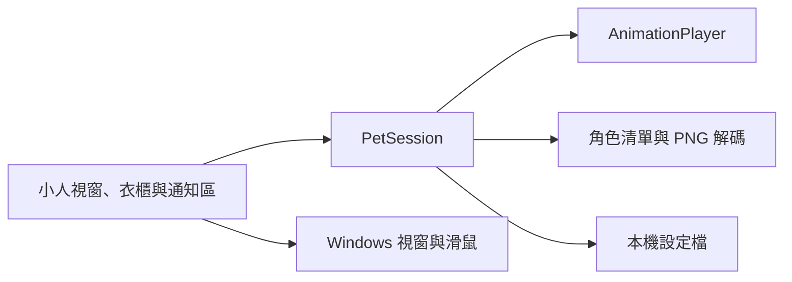

# 桌面寵物程式架構

以 **C#／.NET 10 LTS、WPF、透明 PNG 影格和本機 JSON** 實作單一 Windows 程序。Prototype 先用霍爾海雅和她的兩套造型驗證基建待機、摸摸、拖曳與換裝。角色和時裝由資料描述，之後加入新幹員時共用同一套顯示、互動與播放邏輯。[Prototype 功能方案](prototype-plan.md) · [.NET 支援政策](https://dotnet.microsoft.com/en-us/platform/support/policy)

## 技術選擇

- **桌面視窗用 WPF。** 小人是有逐像素透明度的無框視窗。Windows 依圖像的 Alpha 值判斷點擊落在哪個視窗，逐幀變動的輪廓也沿用同一機制。Electron 的透明視窗若要做到同樣效果，需額外管理可點擊區域。[WPF 視窗透明度](https://learn.microsoft.com/en-us/dotnet/api/system.windows.window.allowstransparency?view=windowsdesktop-10.0) · [Win32 分層視窗](https://learn.microsoft.com/en-us/windows/win32/winmsg/window-features#layered-windows) · [Electron 透明視窗限制](https://www.electronjs.org/docs/latest/tutorial/custom-window-styles#limitations)
- **衣櫃用 WPF XAML，通知區圖示用 WinForms `NotifyIcon`。** 以繁體中文顯示造型名稱、當前選擇與素材狀態。通知區提供顯示、隱藏、衣櫃、選擇素材資料夾及結束程式。小人與通知區的衣櫃命令共用同一個視窗，資料夾選擇用 WPF 的 `OpenFolderDialog`。[WPF 與 WinForms 控制項](https://learn.microsoft.com/en-us/dotnet/desktop/wpf/advanced/windows-forms-controls-and-equivalent-wpf-controls) · [OpenFolderDialog](https://learn.microsoft.com/en-us/dotnet/api/microsoft.win32.openfolderdialog?view=windowsdesktop-10.0)
- **動畫採逐幀播放。** 待機和摸摸都是固定片段，素材準備時輸出透明 PNG 即可。這會增加素材檔案數，換來簡單的播放器，並讓素材工具與版本留在準備階段。直接播放 Spine 的優勢是骨骼混合與即時變形，會連帶引入版本配對、渲染交接與 Runtime 授權。Prototype 以同畫布的 PNG 序列交付素材。[Spine 匯出格式](https://esotericsoftware.com/spine-export) · [Spine Runtime 授權](https://esotericsoftware.com/licenses/Spine-Runtimes-License-Agreement.pdf)
- **設定及素材清單用 `System.Text.Json`。** 資料存在本機，可直接閱讀，版本各自管理。程式只需一個通知區程序，在同一 Windows 登入工作階段用具名 Mutex 維持單一實例。
- **平台以 Windows x64 為準。** 先在本機 Windows 11 驗收，再測 Windows 10 21H2 LTSC x64。Microsoft 將 .NET 10 的 Windows 10 支援列在特定 LTSC／企業版，其他版本依實機結果記載。[Windows 版本支援表](https://learn.microsoft.com/en-us/dotnet/core/install/windows#supported-versions)

## 程式分工

```text
docs/
src/
  ArtPet.Core/          net10.0
    Assets/             角色定義、素材清單讀取
    Animation/          影格時間與動作切換
    Placement/          螢幕位置的座標計算
    Settings/           設定資料與檔案存取
  ArtPet.Windows/       net10.0-windows
    App.xaml.cs         啟動、物件組裝、結束
    PetSession.cs       角色、時裝與顯示狀態
    Desktop/            小人視窗、滑鼠、DPI 和通知區圖示
    Wardrobe/           衣櫃與畫面狀態
    Media/              PNG 解碼與畫面更新
tests/
  ArtPet.Core.Tests/    MSTest，純 C# 邏輯與本機檔案測試
```



- **`ArtPet.Core`** 以 C# 紀錄型別表示 `CharacterPack`、`OutfitDefinition`、`AnimationClip` 和 `PetSettings`。角色清單讀取、動畫時間計算及螢幕位置換算可在一般測試程序驗證。核心相依於 .NET 標準函式庫。
- **`ArtPet.Windows`** 將透明視窗和滑鼠輸入放在 `Desktop`、換裝畫面放在 `Wardrobe`、PNG 解碼和畫面更新放在 `Media`。Win32 呼叫集中在 `Desktop`，XAML 的事件處理只轉交操作或更新畫面。
- **`PetSession`** 是桌面層唯一變更當前角色、已套用時裝和可見狀態的地方。視窗與通知區呼叫同一個工作階段，衣櫃依它顯示時裝與載入進度。`App.xaml.cs` 建立相依物件並管理啟動與退出。方法使用具體動詞和參數，註解用來解釋 DPI、焦點或執行緒等容易誤解的行為。
- 實作時以 `ArtPet.slnx` 管理方案，用 `global.json` 記錄 .NET 10 SDK 版本並允許同版本帶的修補更新，開啟 Nullable。UI 依賴方向固定為 `ArtPet.Windows → ArtPet.Core`。

## 桌面互動與動畫

**透明顯示。** `PetWindow` 使用 `WindowStyle=None`、`AllowsTransparency=true`、透明背景及 `ShowInTaskbar=false`。以 `ShowActivated=false` 開啟，點擊小人時回傳 `MA_NOACTIVATE`，讓視窗繼續收到滑鼠訊息，同時保留原本的前景視窗。小人的右鍵選單提供衣櫃、大小、置頂及隱藏。衣櫃是可接收鍵盤輸入的普通 WPF 視窗。[Win32 滑鼠啟用訊息](https://learn.microsoft.com/en-us/windows/win32/inputdev/wm-mouseactivate)

**摸摸與拖曳。** 主鍵按下時記錄螢幕座標，超過 Windows 的拖曳閾值才移動。短按放開時以 `WindowFromPoint` 確認游標仍位於小人的可見區域。按下和放開皆命中小人，且位移低於閾值時觸發摸摸。由於背景視窗的滑鼠擷取範圍有限，從按下到完成手勢期間，以短時的 `DispatcherTimer` 讀取游標及 Windows 主鍵對應的實體按鍵。移動用 `SetWindowPos` 的 `SWP_NOACTIVATE` 保持前景視窗。放開、隱藏或結束時停止手勢計時。所有放開路徑走同一個完成方法，避免重複觸發和拖曳後誤播動畫。[Win32 滑鼠擷取](https://learn.microsoft.com/en-us/windows/win32/api/winuser/nf-winuser-setcapture) · [讀取滑鼠按鍵狀態](https://learn.microsoft.com/en-us/windows/win32/api/winuser/nf-winuser-getasynckeystate)

**螢幕位置。** WPF 以 DIP 設定視窗大小與內容，桌面位置與拖曳換算使用 Win32 實體像素。在 `app.manifest` 宣告 Per-Monitor V2 DPI awareness，依螢幕工作區與實際視窗尺寸限制放置範圍。記錄顯示器名稱與角色錨點在工作區的比例，換裝和縮放以同一錨點放置，容許靠邊時回到可見範圍。預設為主螢幕右下角、距工作區邊緣各 16 DIP、100% 時畫布長邊為 160 DIP，依素材比例顯示，另有 75% 和 125% 選項，置頂預設開啟。螢幕配置、DPI 變更或從通知區叫回時重新檢查放置位置，副螢幕拔除時回主螢幕右下角。[Per-Monitor V2](https://learn.microsoft.com/en-us/windows/win32/hidpi/dpi-awareness-context) · [螢幕工作區座標](https://learn.microsoft.com/en-us/windows/win32/api/winuser/ns-winuser-monitorinfo)

**播放。** `AnimationPlayer` 循環播放 `idle`，點擊時插入一次 `touch`，結束後從頭播放 `idle`。缺少 `touch` 時，在待機上疊一個約半秒的 WPF 微風特效。反應期間的連點共用當前反應。動畫預設且最高為 24 FPS。可見時用單一 `DispatcherTimer` 依 `Stopwatch` 計算下一幀的絕對時間並設定下次喚醒。延遲時直接取當前影格，角色圖像只在造型、片段或影格索引變更時更新。隱藏時停止計時，叫回時從待機開始。[WPF DispatcherTimer 的調度行為](https://learn.microsoft.com/en-us/dotnet/api/system.windows.threading.dispatchertimer?view=windowsdesktop-10.0)

## 角色素材與換裝

每個角色使用一個本機資料夾。使用者選擇含有 `character.json` 的那一層，程式記住並直接讀取該資料夾。清單採 UTF-8 JSON，描述造型、畫布、錨點與片段。清單內的錨點以畫布左上角為原點，使用原始像素。Prototype 的兩套時裝使用同一個畫布和腳底錨點，換裝時連同整套影格一起切換。下例是格式示意，實際影格數以素材匯出為準。

```json
{
  "schemaVersion": 1,
  "id": "hoolheyak",
  "displayName": "霍爾海雅",
  "defaultOutfitId": "default",
  "canvas": { "width": 256, "height": 256, "anchorX": 128, "anchorY": 224 },
  "outfits": [
    {
      "id": "default",
      "displayName": "預設造型",
      "preview": "default/preview.png",
      "idle": { "directory": "default/idle", "fps": 24, "frameCount": 72 },
      "touch": { "directory": "default/touch", "fps": 24, "frameCount": 24 }
    },
    {
      "id": "winds-of-time",
      "displayName": "歷世流風",
      "preview": "winds-of-time/preview.png",
      "idle": { "directory": "winds-of-time/idle", "fps": 24, "frameCount": 72 }
    }
  ]
}
```

- **影格規格。** 每段從 `0000.png` 開始依序命名。例如 `default/idle/0000.png`，依 `frameCount` 讀取所列序列。目錄和預覽路徑相對於角色資料夾，解析後須位於該資料夾內。第 1 版清單需有非空白 ID，造型 ID 唯一，預設造型存在，畫布尺寸為正且錨點在畫布內。降採樣前核對 PNG 的原始尺寸是否符合畫布，驗證幀率介於 1 至 24 FPS、影格數為正且影格可解碼。每套以 `idle` 為必要片段。`touch` 缺失或讀取失敗時用微風，`preview` 缺失或讀取失敗時優先用待機首幀。必要片段無法載入時才將該造型標為暫不可用。
- **素材準備。** 依原素材的使用條件準備本機透明 PNG 序列。若手上是 Spine 骨架檔，使用相符版本的工具讀取骨架、圖集和貼圖，輸出每個動作的透明序列，再將兩套影格對齊同一畫布。Esoteric Software 的 Spine Editor／CLI 提供匯入和匯出功能，影像匯出需要具視窗系統和 OpenGL 的環境。PRTS 是參考索引。霍爾海雅預設基建資料已有索引，「歷世流風」的可用基建素材尚待實際驗證。[Spine CLI](https://esotericsoftware.com/spine-command-line-interface) · [霍爾海雅基建索引](https://prts.wiki/w/霍尔海雅/spine)
- **載入與換裝。** 選擇新素材資料夾後，先驗證清單並載入預設造型，才一起更新角色、衣櫃和目前的素材路徑，接著排程保存設定。驗證期間保持原來的小人和衣櫃可用。已有角色時沿用目前的顯示或隱藏狀態。衣櫃選擇時，由背景工作用 WPF `BitmapImage` 的 `OnLoad` 完成解碼並 `Freeze()`，關閉檔案後交回 UI。候選造型整套準備好才在同一次 UI 更新中切換並進入新造型的待機。讀取失敗時繼續顯示目前造型。連續換裝時同時只解碼一套候選，取消過時要求，最後一次選擇才可套用。持久設定以成功套用後的時裝為準。[BitmapImage 載入選項](https://learn.microsoft.com/en-us/dotnet/api/system.windows.media.imaging.bitmapimage.cacheoption?view=windowsdesktop-10.0) · [WPF 可凍結物件](https://learn.microsoft.com/en-us/dotnet/desktop/wpf/advanced/freezable-objects-overview)
- **同時操作。** 資料夾與換裝請求共用單一載入流程，帶有請求序號，UI 只套用最新的使用者請求。選回目前穿著的時裝時取消待處理的選擇。跨 DPI 重解碼優先讓手動選擇完成，之後再按顯示尺寸調整目前造型，只在角色、造型和目標尺寸仍相符時更新影格。關閉衣櫃或隱藏小人時，已發出的換裝可以完成。結束程式時取消載入。
- **擴充。** 同一幹員新增時裝時，先加資料夾和清單項目。等單一角色的框架驗收後，角色選單可列出多個遵循同一格式的資料夾，以角色 ID 和造型 ID 記住選擇。新動作有實際需求時，再加入可選片段和對應的觸發條件。

## 設定與錯誤處理

`%LOCALAPPDATA%\ArtPet\settings.json` 由 `System.Text.Json` 寫入，第一版的預設內容如下。

```json
{
  "schemaVersion": 1,
  "packDirectory": null,
  "characterId": null,
  "outfitId": null,
  "placement": null,
  "sizePercent": 100,
  "isTopmost": true
}
```

`placement` 有值時包含 `monitorName`、`anchorX` 和 `anchorY`。錨點為相對螢幕工作區的比例，各介於 0 到 1。`sizePercent` 接受 75、100、125。缺少或超出範圍的偏好欄位使用預設值。使用者完成拖曳、成功選擇素材或換裝，以及更改大小或置頂時自動保存。以單一寫入流程把最新快照寫到同目錄暫存檔，再替換正式檔案，結束時等待最後一次寫入。初次建立用 `File.Move`，已有設定用 `File.Replace`。[File.Replace](https://learn.microsoft.com/en-us/dotnet/api/system.io.file.replace?view=net-10.0)

- 開啟程式時依序嘗試上次選的造型、同資料夾的預設造型。首次未選資料夾或皆無法載入時，保留通知區以便重新選擇。素材可用時，小人從顯示和待機開始，隱藏為當次狀態。
- 螢幕拔除造成的自動移位只作用於當次顯示。設定中的位置在使用者再次完成拖曳時才更新。
- 缺少設定檔時使用預設值。設定檔損毀或格式版本未知時以預設值啟動，下次儲存前將舊檔保存在設定目錄供復原。素材與設定失敗原因寫入本機診斷紀錄，播放時的每幀更新留在記憶體。
- `ShutdownMode=OnExplicitShutdown` 讓通知區控制程序生命週期。退出時停止計時、取消載入並釋放通知區圖示。

## 效能設計與發佈門檻

小人要能常駐桌面。效能通過才完成 Prototype 驗收。

- **減少每幀工作。** 透明視窗使用角色畫布實際需要的範圍。播放時只切換已解碼的 WPF Image，視窗跟隨拖曳時只移動有變化的位置。桌面拖曳的計時器只在主鍵按下後運作，放開或隱藏即停止。[WPF 繪圖負載](https://learn.microsoft.com/en-us/dotnet/desktop/wpf/advanced/optimizing-performance-taking-advantage-of-hardware)
- **依顯示尺寸預載。** `BitmapImage.DecodePixelWidth` 依穩定的實體顯示寬度等比例解碼，最大為素材原始寬度。跨 DPI 拖曳時沿用已載入影格，手勢結束且目標像素大小改變才在背景重解碼，完成後接續當下的影格。衣櫃縮圖在開啟時才以縮小尺寸載入。[WPF PNG 解碼尺寸](https://learn.microsoft.com/en-us/dotnet/api/system.windows.media.imaging.bitmapimage.decodepixelwidth?view=windowsdesktop-10.0)
- **限制快取。** 常駐一套造型，換裝時再載入一套候選。每套解碼影格以 40 MiB 的像素預算計算，超出時先等比例縮小解碼尺寸。144 幀在 200 × 200 像素約 22 MiB，在 256 × 256 像素約 36 MiB，實際程序記憶體另外測量。

採用 Release 測試包和霍爾海雅兩套時裝。基準機關閉衣櫃，待素材載入完成與畫面穩定 15 秒後，再各量測 60 秒的可見待機與隱藏。比較預設大小及 150% DPI 下的最大尺寸，記錄作業系統、CPU、GPU、DPI 和視窗實體像素。CPU 以程序累積 CPU 時間除以量測時間，換算成單一邏輯核心的用量。同時記錄 GPU 引擎與程序私有記憶體。[.NET 程序效能計數](https://learn.microsoft.com/en-us/dotnet/api/system.diagnostics.process?view=net-10.0)

- **動畫。** 對 24 FPS 素材，畫面來源每秒至少更新 23.5 次。記錄 UI 實際切換影格的時間。95% 的相鄰更新間隔在 65 ms 內，整段量測沒有超過 100 ms 的停頓。另在螢幕上確認待機、切換與縮放流暢。
- **互動。** 用至少 20 次已完成的摸摸互動量測，95% 的反應在放開主鍵後 100 ms 內開始。連續移動游標時，95% 的拖曳位置更新間隔在 33 ms 內。
- **CPU、GPU 和記憶體。** 預設大小可見待機平均 CPU ≤ 5% 的單一邏輯核心，私有記憶體 ≤ 100 MiB。放大與高 DPI 下可見待機 CPU ≤ 8%。可見與隱藏相比，同一 GPU 引擎的平均負載增量 ≤ 2 個百分點。
- **隱藏與換裝。** 隱藏穩定後，影格更新數為零，平均 CPU ≤ 0.5% 的單一邏輯核心。連續換裝 20 次期間，舊造型保持播放，私有記憶體峰值 ≤ 160 MiB，量測恢復穩定後比換裝前增加 ≤ 10 MiB。

**已實測的路線。** Windows 11 基準機以 WPF 播放 72 張自製透明 PNG。200 像素視窗中，依下一幀排程的兩次取樣維持約 24 次影格更新／秒，95% 更新間隔在約 60 ms 內，程序 CPU 為單一邏輯核心的 2.6% 至 4.5%。300 像素視窗短測仍約 24 次／秒。隱藏穩定後的取樣為零次影格更新，平均 CPU 約 0.13%。跟隨螢幕刷新事件的對照版本在本機有跳幀，因此待機採用按下一幀排程。實際造型、GPU、拖曳與正式程序記憶體仍依上述門檻驗收。

## 實作順序與驗收

### 開始建置

開發機需有 Windows x64 及 .NET 10 SDK，用 `dotnet --list-sdks` 確認。Windows 專案使用 `Microsoft.NET.Sdk`、`net10.0-windows`、`OutputType=WinExe`，啟用 `UseWPF` 和 `UseWindowsForms`。從專案根目錄建置、執行測試和啟動。[桌面 SDK 專案設定](https://learn.microsoft.com/en-us/dotnet/core/project-sdk/msbuild-props-desktop) · [.NET 10 方案格式](https://learn.microsoft.com/en-us/dotnet/core/compatibility/sdk/10.0/dotnet-new-sln-slnx-default)

```powershell
dotnet build ArtPet.slnx -c Release
dotnet test tests/ArtPet.Core.Tests/ArtPet.Core.Tests.csproj -c Release --no-build
dotnet run --project src/ArtPet.Windows/ArtPet.Windows.csproj -c Release --no-build
```

桌面框架可用同一格式的自製幾何圖形測試素材，兩套配色即可驗證換裝。正式驗收使用可使用的霍爾海雅預設造型和「歷世流風」，每套至少需有透明 PNG 的待機序列和同一個腳底錨點。實際素材資料夾確認可由程式載入後，再進行畫面和效能驗收。

### 實作與測試

案例、實機步驟與記錄方式見 [自動化測試與 Prototype 驗收](testing-and-acceptance.md)。

1. **先完成桌面框架。** 用幾何圖形影格驗證穿透點擊、焦點、快點和拖曳、跨螢幕 DPI、置頂、隱藏與叫回。幾何圖形只用於開發測試，第一位實際角色是霍爾海雅。
2. **接入角色資料和播放。** 先驗收霍爾海雅預設造型，再載入「歷世流風」。確認同一套程式可依兩組資料切換，並在深色和淺色桌布上檢查透明邊緣。測試可選素材損毀、待機影格缺檔、連續換裝和換裝同時跨 DPI。
3. **測試設定與回復。** MSTest 覆蓋待機循環、互動結束、清單／設定驗證和螢幕座標換算。實機驗證副螢幕拔除、不同 DPI、第二次啟動、重開回復設定，以及連續換裝後舊影格被釋放。第二次啟動時由新程序結束，原有通知區及小人照常運作。
4. **產出測試包並驗收效能。** 以 `dotnet publish src/ArtPet.Windows/ArtPet.Windows.csproj -c Release -r win-x64 --self-contained true` 產出 Windows x64 資料夾測試包，用該版本測完效能門檻，隨 SDK 修補更新重新產出。[.NET 發佈方式](https://learn.microsoft.com/en-us/dotnet/core/deploying/)

**已確認。** 在本機 Windows 11 x64 以 .NET 10 WPF 建立重疊視窗，使用自製透明 PNG 測試。Win32 的 `WindowFromPoint` 回報零 Alpha 像素命中下方視窗、不透明像素命中上層視窗，顯示前後前景視窗一致，PNG 也可在關閉資料流後使用。這項測試驗證了透明顯示與點擊判定。

**工具確認。** 本機已可用 .NET 10 SDK 10.0.404。實際拖曳、混合 DPI、Windows 10 相容性、兩套霍爾海雅素材與正式程序的資源用量依上述順序驗收。
